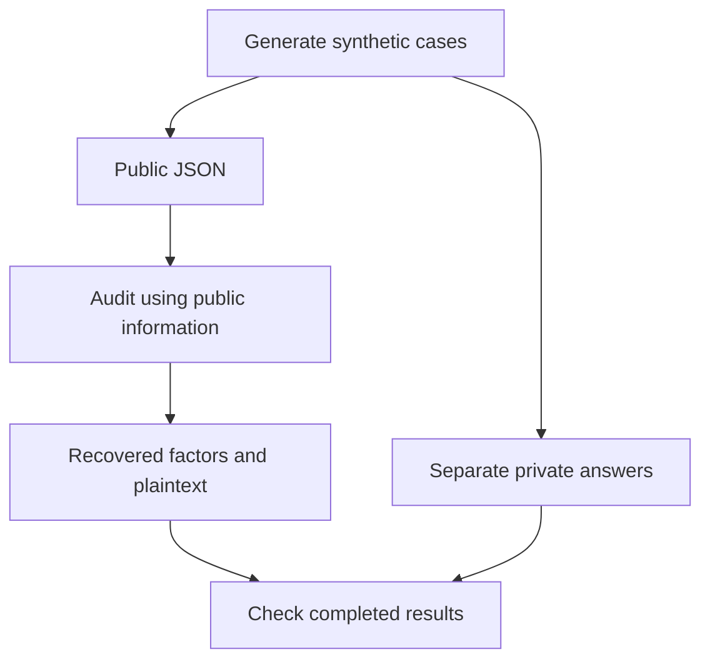

# Reading the auditor code

All program code is inside `rsa_auditor/`. Start with these commands:

```bash
python -m rsa_auditor.cli              # audit command; add mode/options
python -m rsa_auditor.datasets.cli     # dataset-building command; add options
python -m rsa_auditor.experiments.cli  # comparison/benchmark command; add options
```

Run each `cli.py` module directly; separate `__main__.py` launcher files are no
longer used. `__init__.py` marks an ordinary Python package and contains a
one-line description.
The outer project folder holds the application plus data, findings and tests.

The `if __name__ == "__main__"` blocks inside `cli.py` are still needed: they
start the command when executed, while keeping imports safe for other code and
tests. This condition is separate from a file named `__main__.py`.

## Public work and the private answer sheet

Think of a generated dataset as a question paper and a separate marking key:

| Question paper: public input | Marking key: private truth |
| --- | --- |
| neutral ID, modulus n, exponent e, ciphertext | original p/q, case labels, actual gaps, expected plaintext |
| given to the auditor | given to the evaluator |
| enough to attempt recovery | enough to check whether recovery was correct |

The auditor's recovered factors are calculated outputs. The evaluator compares
them with the generator's saved factors; it does not supply them to the attack.
The private JSON is an ordinary local file containing synthetic test answers.
“Private” describes its role in the experiment, not a second attack or thread.



For the demo, `--evaluate` loads private truth after scanning and recovery.
Experiment runners may prepare an independent reference before their timed
runs; that reference stays in the experiment/evaluation code and is never
passed to a scanner. Scanning still works without a private file. The exact
expected-answer comparison is available because these are controlled fixtures.

## Follow one complete run

1. `cli.py` reads options and loads public records through `datasets/storage.py`.
2. `audit_pipeline.py:run_audit` validates options and calls `public_inputs.py`
   to deduplicate by modulus while retaining every ID and exponent.
3. `attacks/pairwise_gcd.py` or `attacks/batch_gcd.py` checks shared factors.
   `attacks/fermat.py` supplies the bounded interface to Krystal's unchanged
   original baseline. Combined mode searches only the remaining moduli.
4. The pipeline validates successful factor products and maps one result back
   to all original records. `key_recovery.py:recover_messages` reconstructs
   keys and decrypts using recovered factors, outside scan timing.
5. Optional `evaluation.py:evaluate_audit` grades those results against the
   separate answer sheet prepared by `build_reference` in the same file.
6. `cli.py` prints the audit and can save its lossless JSON report.

The demo and correctness/coverage studies all use `run_audit`. There is one
normalization, attack selection and record-mapping path. Raw batch diagnostics
are available directly through `attacks/batch_gcd.py:scan_moduli_batch` with
`resolve_full_gcd=False`; they are not another top-level audit mode.

## Find a responsibility

| Group | Purpose |
| --- | --- |
| `attacks/` | Public-number factor searches; no private fixture input |
| `datasets/` | Generate, assemble and save synthetic collections |
| `evaluation.py` | Independent answer-sheet and result validation |
| `experiments/` | Repetitions, work/timing measurements, summaries and plots |
| `public_inputs.py` | Public-record validation and deduplication |
| `constants.py` | Shared algorithm names and work-counter names |
| `key_recovery.py` | Factor checks, inverse arithmetic and OAEP recovery |
| `audit_pipeline.py` | Select and connect the public checks |

Within `experiments/`, start with `cli.py`, then open the selected study:
`comparison.py` for the shared three-mode run, `gcd_scalability.py` for batch
versus pairwise timing/memory, `gcd_checks.py` for correctness/coverage, or
`plots.py` for saved-result aggregation and figures. `common.py` contains the
shared loading, counted execution and source-provenance utilities.

Correctness and coverage now time the shared `run_audit` scan, including common
factor validation. Scalability/stress still time the direct GCD kernel calls.
Each new run's metadata states its boundary; historical measurements retain
their original producer and timing definition.

`datasets/builder.py` is the assembly logic; `datasets/cli.py` is argument
handling. The generator filenames describe what they create: `shared_primes`,
`close_primes` and `controls`. Stored inputs and reported result formats remain
the same as before this refactor.

The integrated program keeps Krystal's algorithms in two ordinary modules:
`attacks/fermat.py` contains the baseline, optimized variants and bounded audit
entrypoint; `datasets/generators/close_primes.py` contains her generation
methods and the shared dataset entrypoint. There are no separate `_original.py`
copies. The integrated budgeted path uses the baseline; the dedicated pilot
compares the baseline and optimized variants. The original source is retained
on `close-primes`.

Current measurements are in `results/comparison`, `results/gcd` and
`results/fermat`. Metadata identifies their original code revision and exact
inputs. Old code/results remain in Git history; see `CONTRIBUTIONS.md` and
`PUBLISHING.md`. Source cleanup does not rewrite those measurements.

## Coding style

Use the [Google Python style guide](https://google.github.io/styleguide/pyguide.html)
as the reference. Prefer ordinary functions and explicit loops or conditions
when they make an algorithm easier to follow. Use `snake_case`, four-space
indentation, grouped imports and short docstrings. Keep the standard RSA names
`n`, `p`, `q` and `e`: `n = p * q`, and `e` is the public exponent. Comments
should explain the mathematical step or boundary, rather than repeat the code.

`.style.yapf` selects Google's formatter settings. With YAPF installed, format
application code with `python -m yapf --in-place --recursive rsa_auditor`.
Saved results retain the revision and hashes of their original producer code;
their timing values were not regenerated during the readability refactor.

The data passed between functions uses ordinary dictionaries and lists. There
is no separate type-class hierarchy to learn. Follow the dictionaries built in
each function: the main public fields are `key_id`, `n`, `e` and optional
`ciphertext`; recovered findings add `p`, `q`, a status and the method used.

## Follow the attack logic

For pairwise GCD, read `euclidean_gcd` and the nested pair loop in
`attacks/pairwise_gcd.py`. If `n1 = p*q1` and `n2 = p*q2`, their GCD reveals
`p`; division gives the other factors. The rest of the function validates
inputs and factors, records findings, and counts work.

For batch GCD, read `build_product_tree`, `compute_leaf_remainders`, then
`compute_batch_gcds`. With `P` the product of the moduli, the core expression is
`gcd(n, (P % (n*n)) // n)`. `scan_moduli_batch` interprets those results and
handles `g == n` by looking for a companion that reveals a proper factor.
The remainder helper takes the tree returned by `build_product_tree`; it does
not revalidate that internally built tree. The scanners still validate public
moduli, backend results and recovered factors.

For Fermat, read Krystal's `fermat_attack`, then her filtered and wheel variants
in the same file. `fermat_factor` checks the public parameters and translates
the baseline's result into the audit report format.

These are reading instructions, not declarations of student-only authorship.
Use the confirmed authorship notes in `CONTRIBUTIONS.md` for that declaration.
