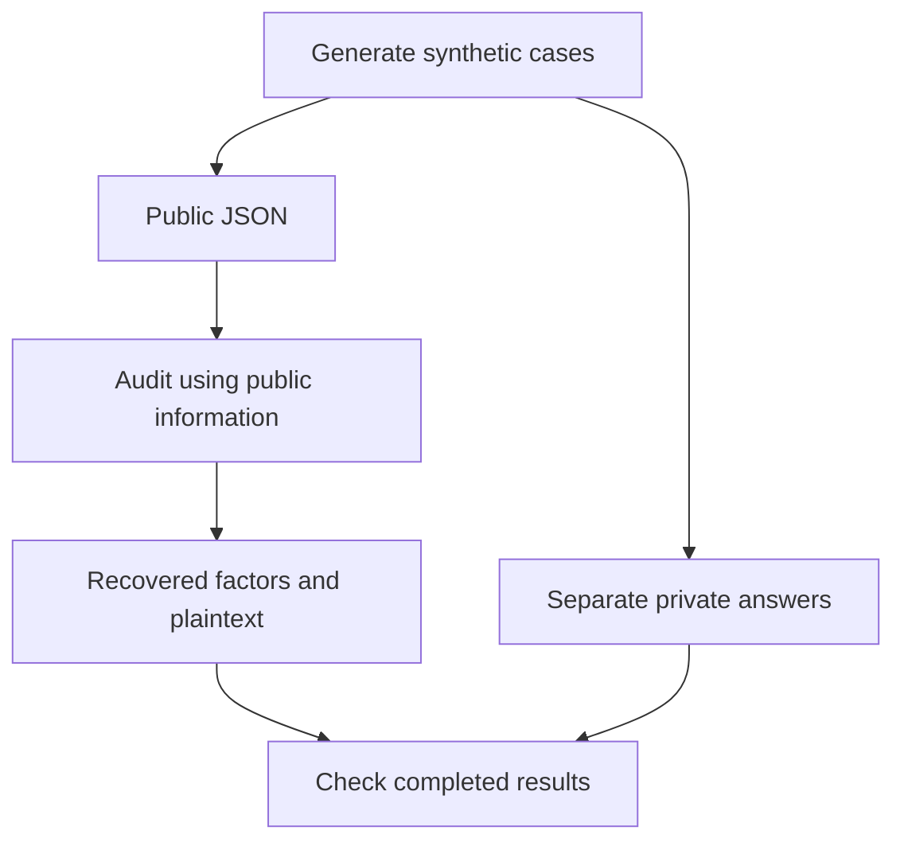

# Reading the auditor code

Start with the package commands. All program code is inside `rsa_auditor/`:

```bash
python -m rsa_auditor               # audit command; add mode/options
python -m rsa_auditor.datasets     # dataset-building command; add options
python -m rsa_auditor.experiments  # comparison/benchmark command; add options
```

Each package's `__main__.py` launches its `cli.py`. `__init__.py` marks a Python
package; these are small infrastructure files rather than duplicate programs.
The outer project folder holds the application plus data, findings and tests.

## Public work and the private answer sheet

Think of a generated dataset as a question paper and a separate marking key:

| Question paper: public input | Marking key: private truth |
| --- | --- |
| neutral ID, modulus n, exponent e, ciphertext | original p/q, case labels, actual gaps, expected plaintext |
| given to the auditor | given to the evaluator |
| enough to attempt recovery | enough to check whether recovery was correct |

The auditor's recovered factors are calculated outputs. The evaluator compares
them with the generator's saved factors; it does not supply them to the attack.
The private JSON is an ordinary local file containing synthetic test answers.
“Private” describes its role in the experiment, not a second attack or thread.



For the demo, `--evaluate` loads private truth after scanning and recovery.
Experiment runners may prepare an independent reference before their timed
runs; that reference stays in the experiment/evaluation code and is never
passed to a scanner. Scanning still works without a private file. The exact
expected-answer comparison is available because these are controlled fixtures.

## Follow one complete run

1. `cli.py` reads options and loads public records through `datasets/storage.py`.
2. `audit_pipeline.py:run_audit` validates options and calls `public_inputs.py`
   to deduplicate by modulus while retaining every ID and exponent.
3. `attacks/pairwise_gcd.py` or `attacks/batch_gcd.py` checks shared factors.
   `attacks/fermat.py` supplies the bounded interface to Krystal's unchanged
   original baseline. Combined mode searches only the remaining moduli.
4. The pipeline validates successful factor products and maps one result back
   to all original records. `key_recovery.py:recover_messages` reconstructs
   keys and decrypts using recovered factors, outside scan timing.
5. Optional `evaluation/checks.py` grades those results against the answer
   sheet prepared by `evaluation/reference.py`.
6. `cli.py` prints the audit and can save its lossless JSON report.

The older `audit_public_keys` entrypoint is retained for GCD experiments and
supports diagnostic raw batch output. The three-mode `run_audit` entrypoint
uses complete GCD backends. Their roles remain distinct.

## Find a responsibility

| Group | Purpose |
| --- | --- |
| `attacks/` | Public-number factor searches; no private fixture input |
| `datasets/` | Generate, assemble and save synthetic collections |
| `evaluation/` | Independent answer-sheet and result validation |
| `experiments/` | Repetitions, work/timing measurements, summaries and plots |
| `public_inputs.py` | Public-record validation and deduplication |
| `records.py` | Common dictionary/type definitions and counter names |
| `key_recovery.py` | Factor checks, inverse arithmetic and OAEP recovery |
| `audit_pipeline.py` | Select and connect the public checks |

Within `experiments/`, start with `cli.py`, then open the selected study:
`comparison.py` for the shared three-mode run, `gcd_scalability.py` for batch
versus pairwise timing/memory, `gcd_checks.py` for correctness/coverage, or
`plots.py` for saved-result aggregation and figures. `common.py` contains the
shared loading, counted execution and source-provenance utilities.

`datasets/builder.py` is the assembly logic; `datasets/cli.py` is argument
handling. The generator filenames describe what they create: `shared_primes`,
`close_primes` and `controls`. Stored inputs and reported result formats remain
the same as before this refactor.

The integrated program reuses two unchanged original files:
`attacks/fermat_original.py` and
`datasets/generators/close_primes_original.py`. Their small adapters supply the
shared input/budget/result contracts. The original Fermat file includes the
baseline and optimized variants; the integrated budgeted path uses the baseline.

Historical standalone scripts were removed from this branch's working tree
because the integrated auditor does not use them. The full source remains on
`close-primes` at immutable commit `bd60ccb` and `gcd` at `2660d26`; Git history
also retains every removed copy. Their measured close-prime outputs are in
`results/close_primes/`. The current shared runner does not regenerate those
standalone studies. New runs of cryptographic generators do not reproduce the
same primes merely by reusing a shuffle seed.

Historical measurement files keep their original code revision and hashes.
The migration JSONs document past layouts at their recorded commits, rather
than claiming that all historical paths still exist in the current tree.
